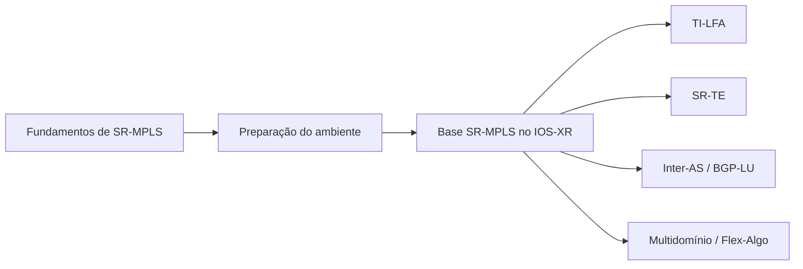

# Segment Routing

## :material-bookmark: **Introdução**

Esta seção reúne material conceitual e laboratórios reproduzíveis de **Segment Routing (SR)**. O conteúdo separa os conceitos independentes de fabricante, apresentados nesta página, das implementações específicas de cada plataforma, organizadas nas subpáginas por fabricante.

Os laboratórios usam **Containerlab** e a temática da **Rede Ipê**. Cada cenário tem topologia, configurações completas dos nós e um roteiro de verificação passo a passo.

!!! warning "Material em desenvolvimento"
    Os laboratórios de Segment Routing estão em evolução. Os cenários concluídos estão listados no [roadmap](#roadmap) ao final desta página.

!!! info "Repositório dos laboratórios"
    Topologias (`lab.clab.yml`), configurações (`configs/*.cfg`) e roteiros originais ficam no repositório **<a target="_blank" href="https://github.com/rnpbr/LabRedes-segmentrouting">github.com/rnpbr/LabRedes-segmentrouting</a>**. Cada roteiro também mostra esses arquivos na própria página.

---

## :material-map-marker-path: **Por onde começar**

1. Leia os [fundamentos de SR-MPLS](#fundamentos-de-sr-mpls) nesta página.
2. Prepare Docker, Containerlab e a imagem Cisco XRd com o [guia de preparação do ambiente](Cisco/01-preparacao-do-ambiente.md).
3. Conheça as convenções na [base SR-MPLS no IOS-XR](Cisco/02-base-sr-mpls.md).
4. Escolha uma trilha no [índice de laboratórios Cisco](Cisco/index.md).
5. Antes de cada lab, leia a página de conceitos da trilha.

---

## :material-school: **Fundamentos de SR-MPLS**

Base conceitual comum a todos os laboratórios de SR-MPLS desta seção. A configuração de referência em IOS-XR está na [base SR-MPLS no IOS-XR](Cisco/02-base-sr-mpls.md).

### Segment Routing

No Segment Routing, o nó de entrada codifica no pacote uma sequência de instruções, ou segmentos, que descreve o encaminhamento desejado. Os nós intermediários executam a instrução ativa sem manter estado por LSP.

No data plane MPLS, cada Segment Identifier (SID) é representado por um label. A lista de segmentos torna-se uma pilha de labels imposta pelo nó de entrada.

### Tipos de SID

- **Prefix-SID:** identifica um prefixo IP e tem significado global no domínio SR. Quando identifica a loopback de um roteador, também é chamado de Node-SID.
- **Adjacency-SID:** identifica um enlace de saída e tem significado local no nó que o anuncia.
- **Binding-SID:** representa uma política ou lista de segmentos completa e permite compor políticas sem expor todos os segmentos internos.

### Blocos de labels

O **SRGB** (Segment Routing Global Block) contém os labels usados pelos SIDs globais. Quando os nós usam o mesmo bloco, um Prefix-SID index é traduzido de forma consistente em `label = base do SRGB + index`.

O **SRLB** (Segment Routing Local Block) reserva labels cujo significado é local, como determinados Adjacency-SIDs e Binding-SIDs.

### Distribuição pelo IGP

O próprio IGP anuncia os SIDs e atributos de Segment Routing. O OSPFv2 utiliza as extensões da RFC 8665 e o IS-IS, as extensões da RFC 8667. Não é necessário um protocolo separado de distribuição de labels dentro do domínio SR.

### Próximas leituras

- [TI-LFA](Cisco/TI‑LFA/index.md): proteção e reconvergência.
- [SR-TE](Cisco/SR‑TE/index.md): engenharia de tráfego com SR Policy.
- [Inter-AS](Cisco/Inter‑AS/index.md): transporte rotulado entre domínios.
- [Multidomínio](Cisco/Multidomínio/index.md): Flex-Algo e SID anycast entre domínios IGP.

### Glossário

| Termo | Significado |
|---|---|
| **Color** | Identificador numérico da intenção associada a uma SR Policy. |
| **Endpoint** | Endereço de destino de uma SR Policy. |
| **Flex-Algo** | Algoritmo SPF adicional, com restrições próprias, distribuído pelo IGP. |
| **Segment list** | Sequência ordenada de SIDs; no SR-MPLS, uma pilha de labels. |
| **SR Policy** | Política identificada por color e endpoint que conduz tráfego por um caminho SR específico. |

---

## :material-flask: **Laboratórios por fabricante**

### Cisco IOS-XR

Implementações executadas em Containerlab com **Cisco XRd** (`ios-xr/xrd-control-plane:7.10.2`).

| Trilha | Laboratórios |
|---|---|
| [TI-LFA](Cisco/TI‑LFA/index.md) | [zero-segment](Cisco/TI‑LFA/00-zero-segment.md), [single-segment](Cisco/TI‑LFA/01-single-segment.md), [double-segment](Cisco/TI‑LFA/02-double-segment.md) |
| [SR-TE](Cisco/SR‑TE/index.md) | [explicit-policy](Cisco/SR‑TE/explicit-policy.md) |
| [Inter-AS](Cisco/Inter‑AS/index.md) | [bgp-lu](Cisco/Inter‑AS/bgp-lu.md) |
| [Multidomínio](Cisco/Multidomínio/index.md) | [flex-algo-anycast](Cisco/Multidomínio/flex-algo-anycast.md) |

- **Link**: [Laboratórios Cisco IOS-XR](Cisco/index.md).

---

## :material-road-variant: **Roadmap**

Cobertura atual e cenários que o projeto pretende desenvolver.

- **Concluído:** lab funcional, com configurações, topologia e roteiro.
- **Planejado:** cenário no escopo, ainda sem lab.

### Fundamentos SR-MPLS

| Cenário | Status | Onde |
|---|---|---|
| Prefix-SID, Node-SID, SRGB, SRLB e OSPFv2 com extensões SR | Concluído | [Fundamentos](#fundamentos-de-sr-mpls) e [base Cisco](Cisco/02-base-sr-mpls.md) |
| Mesmos fundamentos sobre IS-IS | Planejado | - |
| BGP-LU para estender o alcance MPLS além do IGP | Concluído | [bgp-lu](Cisco/Inter‑AS/bgp-lu.md) |

### TI-LFA / Fast Reroute

| Cenário | Status | Onde |
|---|---|---|
| Zero-segment | Concluído | [zero-segment](Cisco/TI‑LFA/00-zero-segment.md) |
| Single-segment | Concluído | [single-segment](Cisco/TI‑LFA/01-single-segment.md) |
| Double-segment | Concluído | [double-segment](Cisco/TI‑LFA/02-double-segment.md) |
| LFA e Remote LFA | Concluído, conceitual | [Conceitos de TI-LFA](Cisco/TI‑LFA/index.md) |
| TI-LFA sobre IS-IS | Planejado | - |

### SR-TE / SR Policy

| Cenário | Status | Onde |
|---|---|---|
| Explicit policy com segment list estática | Concluído | [explicit-policy](Cisco/SR‑TE/explicit-policy.md) |
| ODN (On-Demand Nexthop) | Planejado | - |
| Automated Steering por Color BGP | Planejado | [Conceitos de SR-TE](Cisco/SR‑TE/index.md) |
| Dynamic path via SR-PCE / BGP-LS | Planejado | Requer controlador externo |
| Policy stitching / Binding-SID recursivo | Planejado | - |
| Weighted ECMP entre candidate paths | Planejado | - |

### Flexible Algorithm

| Cenário | Status | Onde |
|---|---|---|
| Flex-Algo básico com afinidades e SID por algoritmo | Planejado | - |
| Flex-Algo com SID anycast de borda entre domínios | Concluído | [flex-algo-anycast](Cisco/Multidomínio/flex-algo-anycast.md) |

### SRv6

| Cenário | Status | Onde |
|---|---|---|
| SRv6 básico com locators e End SIDs | Planejado | - |
| SRv6 Network Programming com uSID | Planejado | - |

### Multidomínio / Interdomínio

| Cenário | Status | Onde |
|---|---|---|
| OSPF multiprocesso com DBRs compartilhados e Flex-Algo anycast | Concluído | [flex-algo-anycast](Cisco/Multidomínio/flex-algo-anycast.md) |
| Seamless MPLS / BGP-LU interdomínio | Concluído | [bgp-lu](Cisco/Inter‑AS/bgp-lu.md) |
| Transporte inter-AS inspirado na Option C, sem a camada VPN | Concluído | [bgp-lu](Cisco/Inter‑AS/bgp-lu.md) |
| L3VPN inter-AS Option C completa | Planejado | O lab atual implementa apenas o substrato de transporte |
| BGP-EPE com PeerNode SID em SR Policy | Concluído | [bgp-lu](Cisco/Inter‑AS/bgp-lu.md) |
| BGP-EPE centralizado com controlador e BGP-LS | Planejado | Requer controlador externo |
| SR-PCE com visão de topologia interdomínio | Planejado | - |

### Multivendor

| Cenário | Status |
|---|---|
| Huawei VRP, equivalente a TI-LFA e SR-TE básicos | Planejado |
| Juniper Junos, equivalente aos cenários básicos | Planejado |
| Nokia SR OS, equivalente aos cenários básicos | Planejado |
| Interoperabilidade Cisco com outro fabricante no mesmo domínio SR | Planejado |

---

## :material-book-open-variant: **Referências**

- Repositório dos laboratórios: <https://github.com/rnpbr/LabRedes-segmentrouting>
- RFC 8402 — *Segment Routing Architecture*: <https://datatracker.ietf.org/doc/html/rfc8402>
- RFC 8660 — *Segment Routing with the MPLS Data Plane*: <https://datatracker.ietf.org/doc/html/rfc8660>
- RFC 8665 — *OSPF Extensions for Segment Routing*: <https://datatracker.ietf.org/doc/html/rfc8665>
- RFC 8667 — *IS-IS Extensions for Segment Routing*: <https://datatracker.ietf.org/doc/html/rfc8667>
- RFC 9256 — *Segment Routing Policy Architecture*: <https://datatracker.ietf.org/doc/html/rfc9256>
